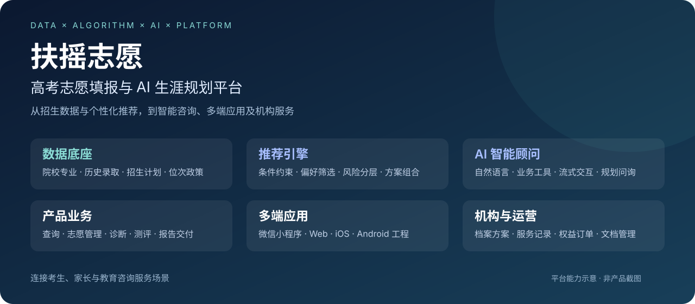

<strong>PROJECT SHOWCASE · iOS / AI APPLICATION</strong>

# 扶摇志愿｜原生 iOS 与 AI 生涯规划

**我主要负责 iOS 客户端开发与跨端业务对齐，把院校查询、志愿选择、AI 问询和生涯报告接入原生移动端体验。**

`Swift` · `SwiftUI` · `MVVM` · `Async/Await` · `SSE` · `API Integration`

## 这个项目解决什么问题

扶摇志愿是一个高考志愿辅助产品。用户需要在成绩档案、院校专业信息、推荐结果和个人志愿表之间持续做选择，进一步通过 AI 问询梳理生涯方向。

我的工作是把这些业务能力转化为原生 iOS 界面和交互，并处理跨入口的数据一致性、网络异步状态和用户操作反馈。

## 我做了什么

| 工作方向 | 我参与实现与完善的内容 | 用户获得的体验 |
|---|---|---|
| 院校与专业查询 | 搜索、筛选、分页、院校详情数据适配及加载状态 | 从查找信息到查看详情，保持查询条件和信息表达连贯 |
| 志愿选择与管理 | 推荐列表、个人志愿表、专业组及子专业选择状态、共享卡片 | 在不同入口查看和管理选择，避免组级标记与单个专业状态混淆 |
| AI 生涯规划 | 原生入口、资料采集、流式问询、选项回复与历史记录 | 在移动端继续多轮问询，并恢复已有规划记录 |
| 报告与分享 | 报告状态展示、文档查询、下载与系统分享入口 | 从完成问询继续进入报告查看和文件取回 |
| 原生交互与性能 | 导航返回、滚动区域、按需加载和流式内容更新节奏 | 让复杂业务在原生界面中更易理解和操作 |

## 我是怎么做的

**先对齐业务，再组织状态，最后落到原生体验。**

1. **业务对齐**：对照既有产品行为，核对地区、年份、批次、科目、档案和筛选条件，再适配接口与字段。
2. **状态设计**：区分首次加载、空结果、刷新、局部选择与异步报告状态，处理搜索触发合并和失败恢复。
3. **身份建模**：为专业组内的子项建立带作用域的状态身份，将组级汇总与单个专业选择分开。
4. **AI 能力接入**：通过流式事件接收文本、选项和状态，将连续问询连接到报告入口。
5. **组件与交付**：复用卡片和显示逻辑，进行分阶段代码检查与构建验证，留下可接续的工程记录。

## 代表性技术亮点

- **搜索调度**：输入防抖与在途请求合并配合，减少多个交互入口反复触发相同列表加载。
- **局部状态反馈**：选择操作采用局部更新与失败回滚，避免每次点击都重载整个页面。
- **专业组建模**：通过院校、专业组和专业行的作用域区分状态，处理同类数据在多个入口的呈现。
- **流式 AI 交互**：把文本、选项、状态与结束事件组织成原生问询过程。
- **异步报告衔接**：区分业务生成状态与文档是否就绪，提供查询、下载和分享路径。

## 继续了解

| 想了解什么 | 看这里 |
|---|---|
| 完整项目介绍与个人贡献 | [项目展示材料](PROJECT_SHOWCASE.md) |
| 架构、实现路径与技术细节 | [我是怎么做的](docs/IMPLEMENTATION.md) |
| 展示范围与资料说明 | [关于本项目展示](ABOUT.md) |

**我的角色：iOS 客户端开发与跨端业务对齐。** 本项目为协作产品，后端推荐、AI 服务及其他端作为协作系统能力；这里展示我的主要工作方向，不将整个平台或全部 iOS 代码归为个人独立开发。

本页依据归档实现与开发记录整理，展示已参与的工程工作；不以此宣称当前线上版本、商店状态或业务效果指标。图为原创能力示意，不是实际 App 截图。
