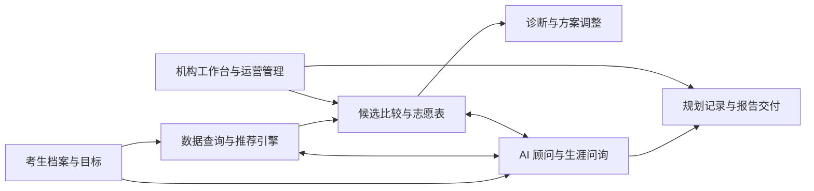

<strong>扶摇志愿 · DATA × ALGORITHM × AI × PLATFORM</strong>

# 扶摇志愿｜高考志愿填报与 AI 生涯规划平台

**中文** · [English](README.en.md)

**以招生数据为基础、推荐算法为引擎、AI 顾问为交互入口，连接考生端应用、机构工作台和运营管理，构建从志愿辅助到生涯规划的产品服务体系。**

## 我们做的是什么

扶摇志愿面向考生、家长及教育咨询服务机构，将院校与专业查询、成绩位次分析、个性化推荐、志愿表管理、AI 咨询、志愿诊断、性格与选科辅助、生涯规划和报告交付连接到同一平台。

平台既服务个人用户的信息查询与方案整理，也提供机构侧的档案管理、志愿方案编辑、生涯规划记录和文档服务能力。

## 平台核心能力

| 能力 | 平台提供什么 | 对应价值 |
|---|---|---|
| 招生与院校数据 | 院校、专业、历史录取、招生计划、地区批次、一分一段与政策信息 | 让查询与方案比较基于统一的数据背景 |
| 个性化推荐 | 成绩/位次匹配、选科约束、院校专业偏好、多条件筛选和风险分层 | 将大量候选信息整理为可比较的选择范围 |
| 志愿管理与诊断 | 专业组与子专业选择、志愿表编辑排序、统计、导出和已有方案诊断 | 连接候选筛选、方案组织与结果检查 |
| AI 智能顾问 | 自然语言问询、结构化工具调用、数据查询、筛选调整和方案解释 | 让用户通过对话理解信息并推进业务操作 |
| 选科与兴趣辅助 | 选科指南、职业兴趣/性格测评及专业职业方向信息 | 把成绩条件与兴趣方向放在同一讨论框架中 |
| 生涯规划与报告 | 资料采集、多轮问询、目标梳理、规划记录、报告文档与下载分享 | 将一次咨询衔接为可保存的规划成果 |
| 多端与机构服务 | 微信小程序、Web、iOS、Android 工程，以及机构和运营管理模块 | 兼顾移动使用、桌面编辑与服务交付 |

## 技术图解

## 平台如何协同工作

**数据提供事实背景，算法组织候选与风险，AI 解释信息并调用业务工具，各端应用承接用户操作，工作台连接服务过程与交付成果。**

## 我们如何建设平台

- **数据与业务统一**：围绕地区、年份、批次、科目及成绩档案组织数据模型，统一多端查询与筛选语义。
- **算法与规则结合**：通过位次/分数匹配、条件约束、偏好筛选、专业组聚合和风险分层形成推荐结果。
- **AI 与工具结合**：让智能顾问调用查询、筛选和志愿管理工具，将自然语言与结构化业务操作连接起来。
- **多端共享服务**：以服务端承接账号、档案、推荐、问询、记录和文档，各端针对使用场景提供交互。
- **咨询与交付衔接**：从档案与会话继续进入志愿方案、生涯规划记录及文档取回，而不止停留在一次文本回答。

## 进一步了解

| 材料 | 内容 |
|---|---|
| [完整平台介绍](PROJECT_SHOWCASE.md) | 项目定位、整体产品体系、关键流程、技术方案与服务价值 |
| [产品能力](docs/PRODUCT_CAPABILITIES.md) | 查询、推荐、诊断、测评、规划、机构与运营模块 |
| [算法与 AI](docs/ALGORITHM_AND_AI.md) | 数据组织、推荐流程、风险分层、Agent 工具与规划交互 |
| [平台技术架构](docs/PLATFORM_ARCHITECTURE.md) | 多端应用、后端服务、数据层、业务一致性与工程机制 |
| [技术详解](docs/TECHNICAL_DETAILS.md) | 批次归一化、两阶段查询、分段映射、工具并行与状态生命周期 |
| [业务场景](docs/BUSINESS_SCENARIOS.md) | 考生、家长和机构如何使用平台能力 |

扶摇志愿以统一的数据模型、推荐服务、AI 工具体系和多端产品支撑志愿填报与生涯规划业务。不同地区的数据覆盖、客户端能力及服务交付方式，以对应产品版本和服务方案为准。
