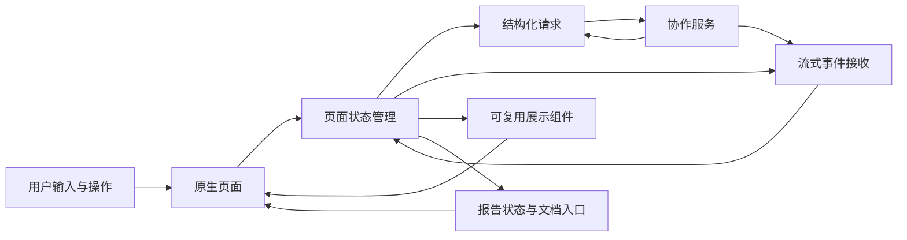
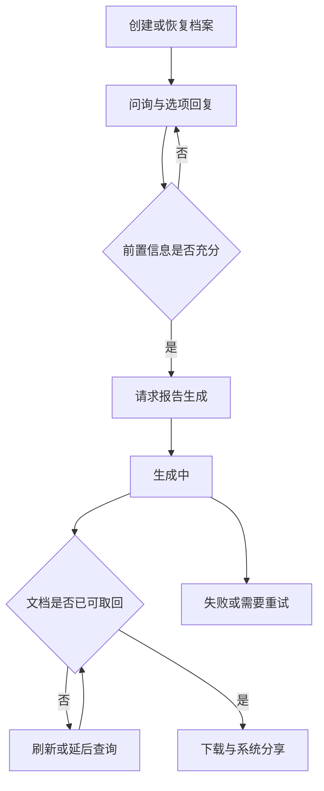

# 架构与状态设计

## 客户端在系统中的位置

原生客户端消费结构化查询结果和流式对话事件，负责把它们组织成可操作的页面。推荐计算与报告生成由协作服务提供；客户端负责上下文传递、显示状态、用户选择和下载分享。

下图是重新绘制的概念结构，省略了真实接口、域名、账号、第三方配置及部署信息。

页面层主要负责布局、导航和动作绑定；状态层负责加载、选择、分页与错误；网络层负责请求和事件解码；模型层承接可选字段与兼容性。归档中的部分生涯规划界面与状态逻辑仍在同一较大文件内，因此这是职责分析，不代表所有边界都已经通过独立文件完全落实。

## 成绩档案是查询上下文

院校详情不仅由院校标识决定。用户查看招生计划、历年分数或推荐专业时，还隐含依赖地区、年份、批次、科目以及成绩档案。将这些条件分散到各页面，很容易让搜索入口与志愿推荐入口对同一对象请求出不同数据。

实践中先比较完整上下文，再比较页面字段。尤其要区分“同一页面的数据不同”和“请求实际去了不同环境或带了不同条件”。客户端不能通过补一段展示逻辑来掩盖上下文不一致。

一种值得进一步明确的设计是将查询上下文作为可传递的值对象，并在请求开始时冻结快照。归档实现中可以看到相关字段和传递逻辑，但本文不把这一统一值对象架构描述为已经全面完成的重构。

## 页面状态不等于数组是否为空

初次进入时结果数组为空，已经请求并返回零条时数组也为空。如果只看数组，会在请求完成前短暂展示“暂无数据”。因此必须把是否加载过与是否正在加载分开。

| 状态 | 可见内容 | 用户应理解什么 |
|---|---|---|
| 尚未开始或首次加载 | 加载提示 | 请求尚未完成 |
| 成功且为空 | 空结果说明 | 本次条件没有匹配结果 |
| 成功且有内容 | 列表和分页入口 | 可以继续查看 |
| 刷新失败但有旧内容 | 继续显示已有列表 | 保留内容不等于刷新成功 |
| 初次请求失败 | 可重试错误态 | 当前没有可用结果 |

归档中搜索实现会保留刷新前的院校列表，并在某些刷新失败分支清除页面错误信息。这改善了连续查看体验，却可能使用户难以知道数据已过期。后续可以增加非阻塞的刷新失败提示和更新时间，而不恢复成全屏错误覆盖。

## 业务选择与页面选择

院校、专业组、子专业不是同一种对象。专业组上的汇总标记表示组内存在某种选择状态，子专业按钮则表示该行自身状态。父级汇总不能直接替代每个孩子的状态。

多个入口应复用相同语义的数据映射和展示组件。复用的价值是避免院校详情、推荐列表和自己的志愿表分别实现一套相似却不一致的判断。卡片宽度和间距也需要统一，但它们不能替代身份和数据状态的一致。

## 对话与报告是不同状态维度

生涯规划至少包含资料采集、对话进行、信息收集完成、报告排队或生成、文件可用、下载分享等步骤。对话结束只能说明一轮交互结束；业务记录标记完成，也不保证文档已经同步。

图中循环表示产品应支持的过程，不意味着归档实现具备无限轮询或完整自动恢复机制。实际代码有延迟查询和手动刷新路径，持续重试与退避仍需要专门验证和设计。

## 性能取舍

归档记录中的优化包括：减少不必要的页面常驻、首次进入再加载、保留需要连续对话的页面状态，以及降低流式文本对滚动操作的触发频率。这些方向针对的是任务数量和更新频率。

项目没有留下可公开复核的帧率、内存或耗电基准，因此这里只说明机制和动机，不给出提升百分比。减少常驻页面还必须与导航返回、草稿恢复和对话保活一起验证。
