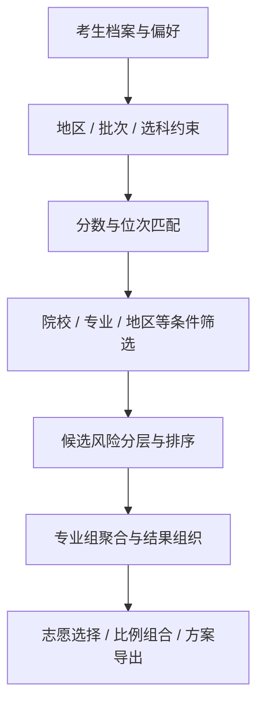

# 算法与 AI｜让数据、推荐和咨询协同工作

[English](ALGORITHM_AND_AI.en.md)

## 一、数据基础

推荐依赖结构化业务背景：考生所在地区、批次、科目、分数与位次，以及院校专业的招生计划、历史表现和相关条件。平台将院校、专业、录取数据、位次表和政策等对象组织到统一模型中。

这样的结构使查询、推荐、志愿表和 AI 工具能够引用相同业务实体，而不是各自拼接一套难以比较的信息。

## 二、推荐流程

### 1. 处理可报条件

先依据地区、批次和科目等约束形成候选范围，再结合用户偏好筛选院校、专业和地区。系统同时区分用户希望纳入或排除的条件。

### 2. 进行分数与位次匹配

位次是推荐中的重要比较信息。平台结合考生位次与候选的历史或预估位次组织筛选范围；分数区间与位次换算可用性也参与条件处理，在适用分支保留直接按分数过滤的方式。

这使条件处理能够适应不同档案及数据形态，而不把所有查询都简化为一个分数阈值。

### 3. 表达相对风险

系统依据候选与考生条件的匹配关系计算参考值，并用于风险分层、候选排序及“冲、稳、保”等产品表达。

这些是规则与数据驱动的辅助参考，不等同于经过独立统计校准的真实录取概率。内部系数、阈值和预测数据受到保护；效果指标采用定义明确、可复现的评估口径。

### 4. 组织专业组和志愿组合

专业组场景需要把匹配的子专业组织到组级结果中，再区分组级状态与单个专业选择。候选结果可以继续进入志愿表，按目标风险比例整理方案并支持编辑排序。

系统保留用户自己的方案顺序，使阅读、编辑和导出能够围绕同一结果展开。

## 三、推荐服务的工程实现

候选查询与详情装载分阶段进行，先处理轻量候选、排序和分页，再补充需要展示的完整信息。专业组相关数据、筛选条件和统计也有相应的聚合与缓存处理。

缓存与查询不是孤立的性能技巧：档案、偏好和选择变化后，相关结果需要重新同步。性能结论以受控环境中的基准测试和线上观测为依据。

## 四、AI 顾问的业务工具体系

平台将智能顾问与以下结构化能力连接：

| 工具方向 | 业务作用 |
|---|---|
| 考生档案 | 了解成绩、位次、地区、批次、选科和相关背景 |
| 院校与专业 | 查询录取信息、专业方向、院校介绍与政策 |
| 条件筛选 | 查看候选范围，添加或移除偏好条件 |
| 志愿管理 | 查看、编辑、统计及组织志愿方案 |
| 会话与记录 | 维护当前问询背景，衔接历史记录与后续操作 |

AI 将用户表达转成工具调用，服务端对参数和权限进行处理，工具返回结构化结果，再组织为解释和页面内容。推荐和方案状态来自业务工具，而不只依赖模型自由生成的文本。

## 五、流式交互与连续任务

服务端通过流式事件传递文本、选项、操作状态和业务结果，终端据此逐步更新界面。会话历史、档案背景及偏好信息为后续交互提供上下文。

平台同时通过任务记录、取消与恢复机制承接多轮交互，并根据传输中断、用户取消和业务失败等不同状态执行相应的恢复策略。

## 六、生涯规划与知识资料组织

生涯规划从资料和目标出发，通过咨询式问询逐步明确约束、兴趣与发展方向。项目包含面向多类升学和就业路径的资料及报告模板组织，并通过规划记录衔接文档服务。

报告服务将业务处理与成果文件管理连接起来；用户看到的报告状态和文档入口分别由业务状态与资源可用性决定。平台保留审核与服务人员参与机制，使 AI 辅助能力进入可管理的交付流程。

## 七、算法与 AI 的关系

**推荐算法负责结构化候选与风险组织，AI 顾问负责理解问题、调用工具和解释结果，多端产品负责把这些能力转化为可操作的流程。**

平台的工程价值在于把三者连接起来，核心技术重点是业务数据、推荐算法、Agent 工具编排和多端产品协同。
