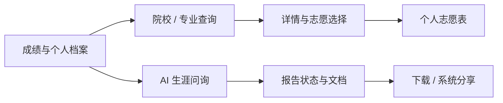
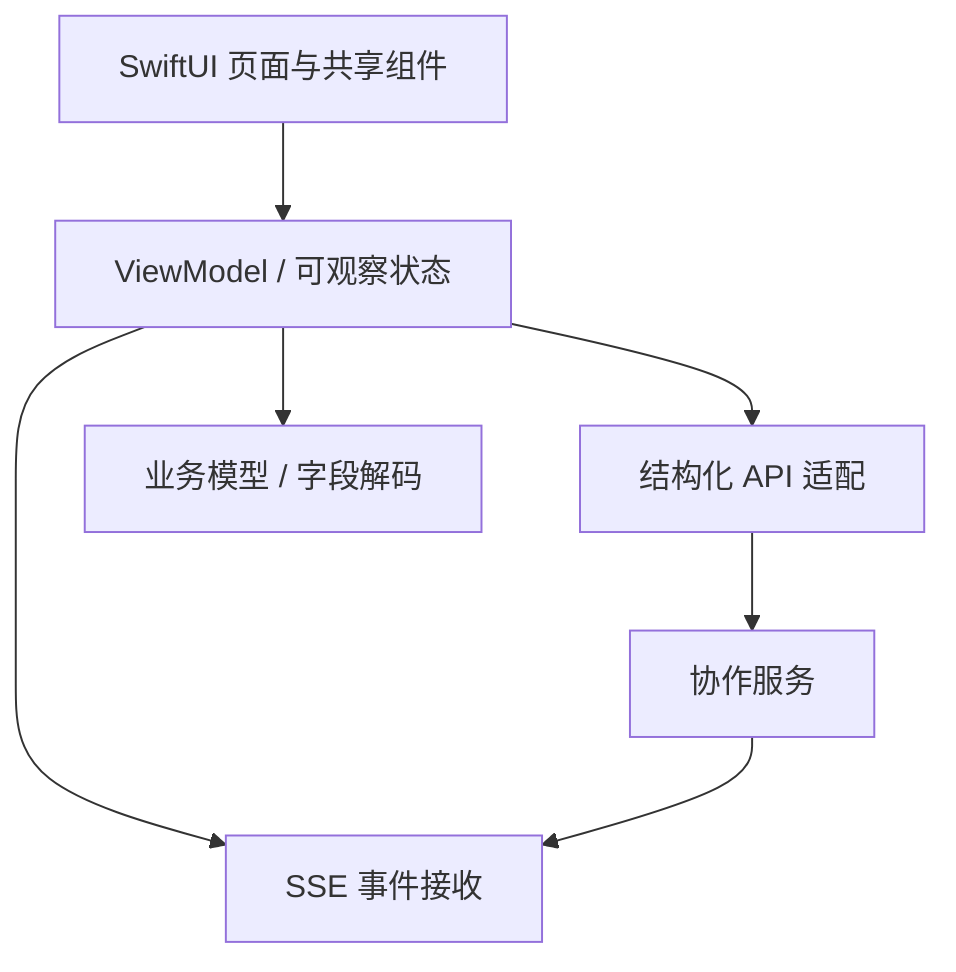

# 我是怎么做的｜技术方案

## 1. 从用户任务组织原生端

用户路径可以理解为“建立档案 → 查询和比较 → 选择志愿 → AI 问询 → 查看报告”。实际产品允许从多个入口进入，下面的图仅表示能力关系，不规定唯一操作顺序。

我的实现工作围绕这些任务安排页面、模型和状态，保持用户在切换入口后仍能继续原来的业务。

## 2. 分离展示、状态与服务接入

- 页面层承接布局、导航、点击动作和系统能力。
- 状态层组织加载、筛选、分页、当前选择和报告阶段。
- 接入层承接结构化请求和流式事件。
- 模型层解释字段、缺失值和兼容形态。

这是对主要职责的概括，实际工程仍有不同粒度的模块。服务端算法与模型编排由协作系统提供，个人工作的重点是客户端接入和产品化。

## 3. 先统一上下文，再比较界面

院校或专业数据不只依赖对象编号，还与成绩档案、地区、年份、批次和科目有关。我的对齐过程先检查这些上下文及查询环境，再比较返回字段和卡片显示。

例如，历年分数和招生计划的科目候选项应分别来自对应数据，不能因为它们在同一个详情页，就复用一套未经区分的筛选来源。可选字段缺失也应保持缺失语义，而非直接转换成有明确含义的零值。

这种处理把界面差异与数据契约联系起来，使问题能定位到具体层次。

## 4. 搜索：防抖与在途合并配合

搜索既可能来自输入，也可能来自筛选、分类和分页。我使用输入防抖压缩连续输入，再用在途状态和待刷新标记协调其他触发：已有加载时记录需要刷新，当前请求结束后读取最新条件继续查询。

同时区分首次请求、已有内容刷新、空结果和加载更多，避免仅凭数组为空就提前展示空态。刷新失败时保留已有院校列表，使用户能够继续查看。

这些是调度与展示机制；严格的最新上下文回写、所有取消组合及刷新过期提示仍需要针对性验证，不能由一次请求成功推导。

## 5. 志愿选择：把身份和聚合拆开

一个子专业的状态不能只依赖组内局部编号。我以院校、专业组和子项的作用域组织状态，将组级汇总与单行按钮分别判断。

选择操作采用“保存旧状态 → 局部显示目标状态 → 提交请求 → 成功协调列表 / 失败恢复”的路径，降低整页重载对连续操作的打断。组级批量选择则单独表达影响的子项范围。

这一设计展示了实体建模和局部状态协调的思路，不将复杂并发下所有回滚组合描述为已经全面验证。

## 6. AI 问询：让事件驱动界面

问询服务返回的不只有文本，还可能包含选项、状态和结束信号。客户端通过事件缓冲与解码，将这些事件转换为原生会话内容、选项卡片和业务进度，并提供取消与异常处理入口。

我把问询入口、历史记录和后续报告动作关联起来，让 AI 能力进入完整用户任务。流式文本接收与滚动更新也分开考虑，避免每一个内容片段都触发完整的界面行为。

## 7. 报告：区分生成状态和文件就绪

生成请求已被接受、业务状态已更新、文本已返回和文档可下载，是不同事实。客户端分别展示报告状态、查询文档并进入下载或分享，文档未同步时引导用户刷新或等待。

报告取回还保留兼容路径，使已有服务能力能够接入原生端。这里展示的是客户端处理方式，不公开内部接口、后台参数或真实报告。

## 8. 用工程检查支撑交付

功能实现后，根据改动范围执行局部代码和语法检查，在相应阶段进行模拟器构建；导航、选项回复、历史恢复和下载分享继续按用户路径安排真机检查。

公开材料展示已参与实现的能力与方法。历史检查和源码观察不等同于当前线上验证，也不替代推荐模型或 AI 输出质量的独立评估。
