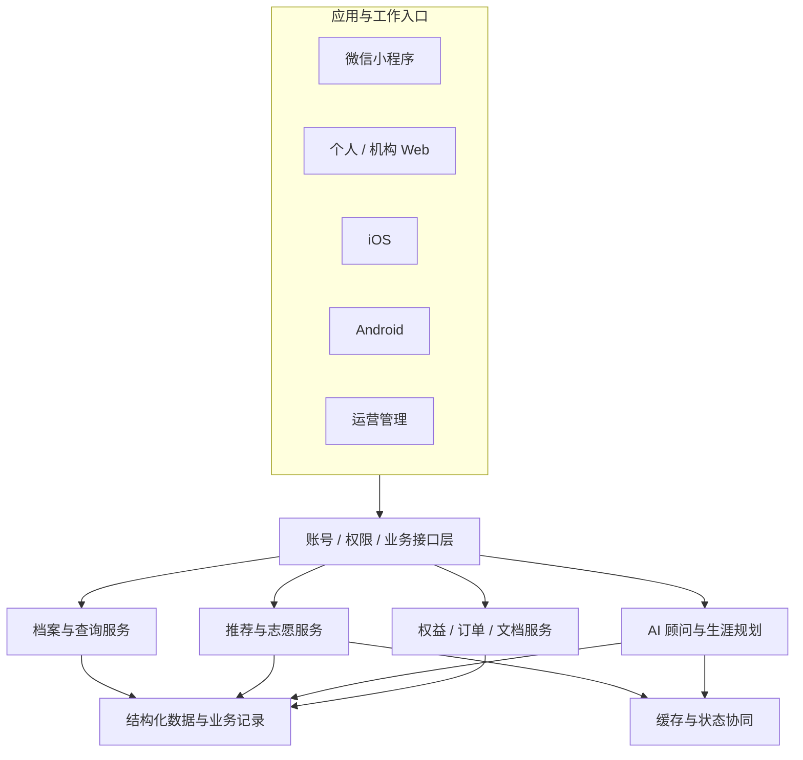

# 平台技术架构｜多端应用与共享业务服务

[English](PLATFORM_ARCHITECTURE.en.md)

## 整体结构

该图描述平台组件及职责关系。生产接口、部署地址、账号、业务参数和内部拓扑按照安全策略管理。

## 技术组成

| 层次 | 项目采用的技术或机制 | 承担职责 |
|---|---|---|
| 服务端 | Python、FastAPI、SQLAlchemy | API、业务规则、查询、推荐、账号和服务流程 |
| 数据与缓存 | MySQL、Redis | 结构化数据、业务记录、筛选统计与缓存等 |
| Web | Vue 3、TypeScript、组件化页面 | 桌面查询、方案管理、机构与用户工作入口 |
| 小程序 | uni-app / Vue 生态 | 微信场景下的移动查询与业务交互 |
| iOS | Swift、SwiftUI、异步状态管理 | 原生页面、查询、问询、规划及系统分享 |
| Android | Kotlin / Gradle 及移动端适配工程 | Android 客户端与共享服务接入 |
| AI 接入 | 工具调用、结构化模型、流式事件 | 将模型问询与业务数据和操作连接 |
| 文档成果 | 文件解析、模板和导出相关服务 | 志愿、诊断与规划文档的保存和取回 |

## 业务模型统一

学生/考生成绩档案、院校专业实体、志愿条目、问询会话、规划记录和文档是平台共享的主要对象。各端通过服务端交互，并针对不同使用场景组织界面。

统一模型不意味着每个端当前版本功能完全相同。平台通过明确数据来源、字段语义和业务权限来协调多端，而不是要求所有页面使用同样的布局。

## 数据契约与跨端一致性

查询上下文包含地区、年份、批次、科目和档案。院校详情、推荐列表和志愿表入口需要保留这些条件；可选字段与不同数据形态在接入和解码层处理。

专业组与子专业状态分别建模，编辑顺序与推荐排序也分别表达。这样的分离减少了相同实体在多个入口被不同解释的机会。

## AI 工具与权限

AI 作为交互入口调用平台工具，参数检查、权限校验和记录归属等仍由业务服务处理。工具状态、执行结果和可展示内容分别组织，再通过流式交互传给终端。

模型接入、业务工具和页面展示分工，使智能交互可以复用结构化查询与志愿操作，而不需要绕开现有业务约束。

## 异步状态与资源

搜索、对话和报告是不同类型的异步过程。列表需要区分首次加载与刷新，会话需要管理事件与取消，报告需要区分处理状态和文件就绪。

平台使用分页、请求协调、缓存同步、历史记录与文档入口承接这些过程。容量与可靠性目标根据具体模块、部署环境及验证结果制定。

## 工程治理与安全边界

平台工程覆盖业务模块、各端应用、配置管理、技术文档、测试和开发检查。内部源码、真实日志、用户资料、敏感配置及部署细节依据权限与安全策略管理；各客户端按照自身版本计划、质量门槛和发布流程交付。
