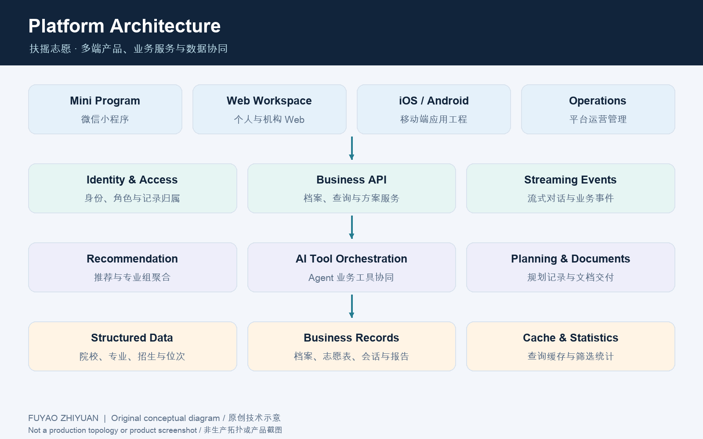
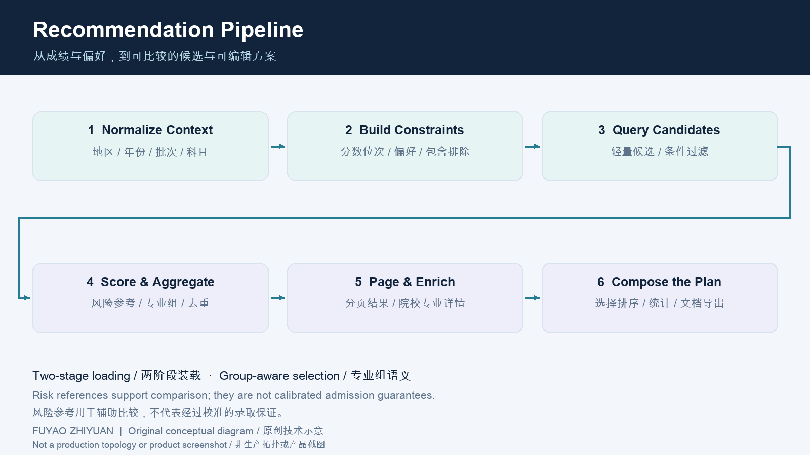
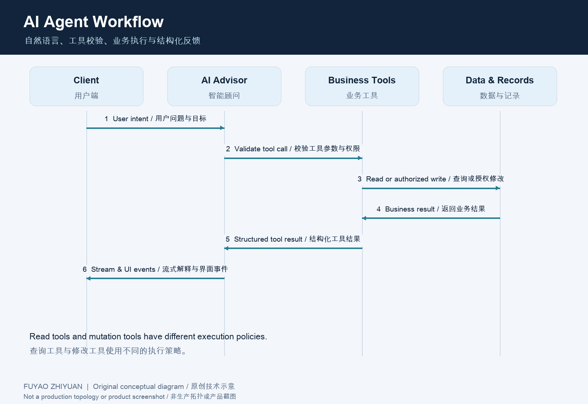

# Technical Deep Dive | Data, Recommendation, Agents and Multi-Client Coordination

[中文](TECHNICAL_DETAILS.md) · [Platform overview](../README.en.md)



## 1. Data modeling and context normalization

The platform models institutions, majors, historical admission results, enrollment plans, rank tables and admission policies as separate entities. Business identifiers connect them with region, year, admission batch and subject constraints. Student profiles, candidate estimates, major groups, application entries, conversations and report documents have distinct responsibilities.

A central concern is separating admission context from the object displayed on a page. Batch names can differ between profile, candidate and group datasets. The query path normalizes a batch and expands it into the labels accepted by the relevant data source. Subject selections become eligibility constraints rather than decorative UI labels.

Historical admission results and current enrollment plans keep their own field provenance. Clients handle optional fields and compatible representations without treating a missing risk reference as a confirmed zero.

## 2. Recommendation execution



### Constraint construction

The engine combines region, batch, score, rank and subject selections with preferences, including positive and negative conditions for institution attributes, locations and majors. Score and rank ranges are handled separately. Where a score-distribution conversion does not yield a usable rank range, the applicable branch can filter directly by score.

### Two-stage queries

The first stage fetches lightweight candidates sufficient for filtering, comparison and pagination. The second loads complete institution, major and historical details for the selected page. Group-level records can be prefiltered by institution attributes before joining eligible child candidates.

This reduces the scope of detail loading. Actual latency still depends on dataset size, indexes, filters and deployment conditions; performance conclusions rely on controlled benchmarks and production observation.

### Risk-reference mapping

The main recommendation path uses interval boundaries and a central anchor in a piecewise mapping, then uses the reference for grouping and ordering. The following generic form explains the mechanism without publishing production anchors, thresholds or coefficients:

Between adjacent anchors (x₀, y₀) and (x₁, y₁):

`f(x) = y₀ + (y₁ - y₀) × (x - x₀) / (x₁ - x₀)`

Boundary handling constrains values outside the intervals. Connected segments form the reference mapping. This is an explanation of computation, not evidence of statistically calibrated admission probabilities.

### Major-group aggregation and plan organization

Eligible child candidates are grouped by institution and major-group identity. A group with matching children can be displayed; redundant group-level filtering should not discard valid child matches. Deduplication, representative-major selection and risk grouping contribute to presentation.

Recommendation ordering and a user's application order have different purposes. The application list preserves manual edits. Business tools can also organize a plan by target risk proportions, summarize its composition and export results.

The following pseudocode summarizes the main responsibilities in the recommendation flow:

```text
context = normalize(student_profile, region_rules)
constraints = combine(context, preferences)
light_candidates = query_eligible_candidates(constraints)
ranked_candidates = assign_reference_scores(light_candidates)
page = paginate(aggregate_if_group_mode(ranked_candidates))
result = attach_details(page)
```

## 3. Caching, statistics and invalidation

Server paths include filter-statistics caches, recommendation caches and serialized result handling. Keys incorporate the profile and normalized filters so results from different preferences are not mixed. Filter updates invalidate relevant statistics or recommendation state.

Caching varies by query path; some candidate queries obtain results directly through the two-stage approach. Selection changes must also coordinate the current list, the user's application plan and any cached state.

## 4. Agent tool execution



Registered tools connect the model to profiles, institutions, majors, policies, candidate filters and application-plan operations. The model interprets the request, selects tools and explains the returned information.

Execution proceeds through argument parsing, input-shape and tool validation, business authorization and context checks, business-function execution, structured results, and user-facing content or events.

Read tools and mutation tools have different execution policies. Registry metadata identifies mutations. A batch enters the parallel path only when all tools are read-only and budget and estimated execution-cost conditions are met. Independent database sessions are used for those calls. Unknown tool behavior is handled conservatively rather than treated as a safe parallel mutation.

Conversation context can contain read results superseded by later updates. Input signatures and mutation-phase markers help identify compressible reads while preserving tool-call/result pairing. System prompts, complete private schemas and internal tool budgets are governed by platform security controls.

## 5. Streaming and task lifecycle

Streaming carries more than text: tool status, structured cards, choices and business state can update the client progressively. Conversation and task services retain relevant records and provide cancellation and recovery-related paths.

A tool failure, transport interruption, user cancellation and business completion are distinct events. Trace and event modules organize the execution record, while recovery or re-execution follows state, persisted progress and business constraints.

## 6. Application-plan parsing and diagnosis

File parsing turns an existing plan into structured records. The workflow then links those records with the student's context, institution/major information and composition statistics before organizing diagnostic content and exportable documents.

Parsing, business analysis and document delivery remain distinct. This lets diagnosis reuse platform data instead of treating an uploaded file as an isolated prompt for an unconnected text response.

## 7. Career planning and report delivery

Planning records link initial information, conversation, goals, collection status, report status and documents. Data collection and consultation advance the case; report services handle deliverables.

The standard delivery workflow uses administrative document processing to advance file availability. After a report request, the system tracks processing and resource-readiness state; lists and downloads become available when documents are ready. Compatibility exporters and on-demand generation paths are managed separately for different service contexts.

The product combines AI consultation, planning services and managed document delivery, with review and service workflows supporting output quality.

## 8. Clients, identity and authorization

Web, WeChat Mini Program, iOS and Android engineering connect to shared identity, profile, recommendation and record services. Web supports desktop and institutional work; mobile clients support discovery, consultation, selection and sharing.

Identity mapping, tokens, roles and record-ownership checks define access to business resources. Individual and institutional workflows can share models while exposing different scopes and actions.

Clients use loading phases, request sequencing, coalesced refreshes, scoped entity identities and local updates to coordinate interaction. The server supplies authoritative business state, keeping actions and presentation connected.

## 9. Technology and data governance

Module responsibilities, query organization, generic mappings, tool execution and state coordination form a maintainable technical system. Production thresholds, internal prompts, real data, private interfaces, credentials and deployment topology are governed by access, security and privacy controls.

Client features follow their product versions. Performance and model quality are evaluated against the applicable environments, datasets and acceptance criteria.
